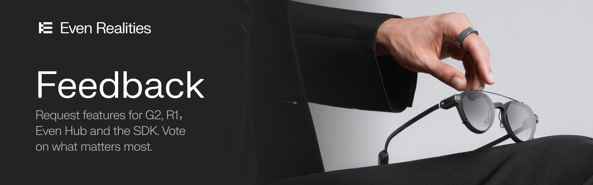

  

# Even Realities Feedback

This is where you tell us what to build next for Even Realities: the G2 and G1 glasses, the R1 ring, the Even Realities app, Even Hub and the developer SDK.

Every request lives in **[Discussions](../../discussions)**, where you can search what others have asked for, upvote it and add your own use case. The most-requested ideas rise to the top, and we update each one as it moves forward.

**[Browse requests →](../../discussions)**  ·  **[Post a new request →](../../discussions/new/choose)**

## How it works

1. **Search first.** Someone may already have asked for what you need. If so, upvote it with 👍 and add a comment about your situation; that tells us more than a duplicate post.
2. **Post one idea per request.** Three ideas means three posts, so each can be voted on and tracked on its own.
3. **Describe the problem, not just the solution.** Tell us what you're trying to do and what's in the way. Sometimes there's a better route than the feature you have in mind.
4. **Vote and follow along.** Upvote the requests you care about, and subscribe to get notified when their status changes.

See **[CONTRIBUTING.md](CONTRIBUTING.md)** for the full posting guide.

## What the statuses mean

Each request carries a status label that we keep up to date.

| Label | What it means |
|---|---|
| **Under Review** | New, or we're still assessing it. Every request starts here. |
| **Planned** | We've decided to build it. Timing may still change. |
| **Shipped** | It's available. The request will link to the release or docs. |

Votes help us prioritize, but they aren't the only factor; we also weigh feasibility, our roadmap and how many people a change helps.

## What belongs here, and what doesn't

| You want to… | Go to |
|---|---|
| Request a feature or improvement | **[Discussions](../../discussions)** (this board) |
| Report a bug, get help, or chat with other users and developers | **[Our Discord](https://discord.gg/RbQnqJUuM)** |
| Learn about Even Realities products | **[evenrealities.com](https://www.evenrealities.com)** |
| Report a security vulnerability | Please don't post it publicly. Contact the team privately instead. |

## Request categories

When you post, pick the area your request is about:

- G2 Glasses Hardware
- G1 Glasses Hardware
- R1 Ring Hardware
- Core Glasses Features
- Companion App & Connectivity
- Even Hub Developer Platform & SDK
- 3rd-Party Apps
- Developer Monetization
- Enterprise & Business
- Community & Events

## Code of conduct

Be kind and constructive. Critique ideas, not people. We'll remove posts that are abusive, off-topic or spam.

---

Maintained by the Even Realities Developer Relations team.
